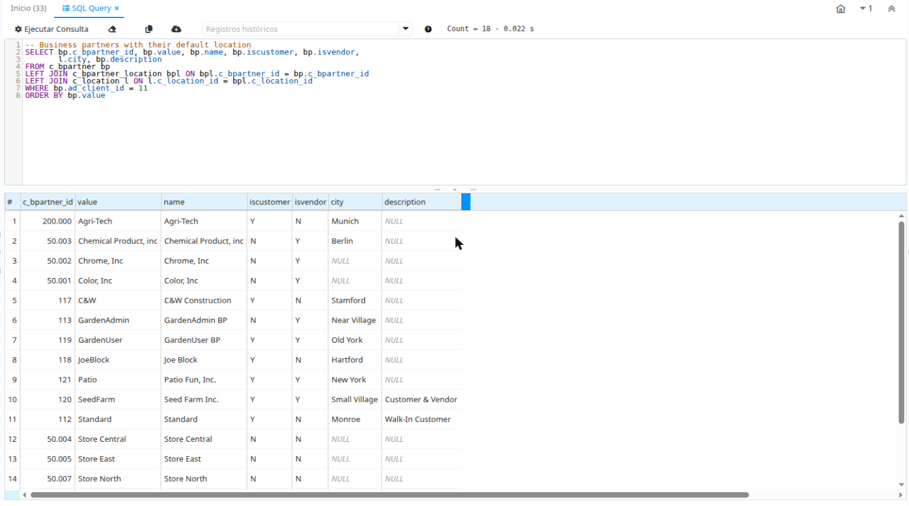

# com.soropeza.sqlquery — SQL Query Enhanced Form

*Leer en [español](README.es.md).*

OSGi plugin for **iDempiere 13** (Java 17, PostgreSQL and Oracle) that replaces the standard
*SQL Query* form with an enhanced version. Version `13.1.0` (see [CHANGELOG](CHANGELOG.md)).



## Based on WSQLQuery

`WSQLQueryEnhanced` is derived from the core form `org.adempiere.webui.apps.form.WSQLQuery`
(Carlos Ruiz, globalqss - bxservice) and keeps its security logic and SysConfig keys
(`FORM_SQL_QUERY_ALLOWED_KEYWORDS`, `FORM_SQL_QUERY_MAX_RECORDS`, `FORM_SQL_QUERY_TIMEOUT_IN_SECONDS`,
`FORM_SQL_QUERY_LOG_ISSUE`). It does not modify the core or the Application Dictionary: an
`IFormFactory` with higher ranking returns the enhanced form when *SQL Query* is opened. Stopping
the bundle restores the standard form.

## Features

- SQL editor with syntax highlighting and line numbers ([CodeMirror](https://codemirror.net/5/) 5.65.16,
  bundled, no CDN). Can be disabled with SysConfig `SQLQUERY_ENHANCED_CODE_EDITOR=N`.
- Run with Ctrl+Enter; with text selected, only the selection runs.
- Tab / Shift+Tab indent and unindent.
- Statement history (last 50 per user) persisted across sessions in its own table `SOP_SQLQueryHistory`.
- `NULL` values shown in grey italics; record count and duration in the toolbar.
- Copy the results (or one row, with double-click) to the clipboard and export to CSV (UTF-8).

## Installation

**Server:** download `com.soropeza.sqlquery-<version>.jar` from
[Releases](https://github.com/sergioropeza/com.soropeza.sqlquery/releases) and install it from the
Felix web console (`https://<server>/osgi/system/console/bundles`, *Install/Update...*, *Start Bundle*)
or from the OSGi console:

```
install file:/path/com.soropeza.sqlquery-13.1.0.jar
start <bundle-id>
```

**Eclipse:** `File > Import > Existing Projects into Workspace`, add the plugin to the server
Run Configuration and start the server.

**Build:** with Java 17 and Maven 3.9+, `mvn verify` (resolves iDempiere 13 from its public p2
repository; the jar is created in `target/`).

## Statement history

Each successfully executed statement is saved in the table `SOP_SQLQueryHistory` (user, statement,
records and elapsed time), created by the plug-in's 2Pack when it is installed. Statements are still
logged in `AD_Issue` like the core form does (SysConfig `FORM_SQL_QUERY_LOG_ISSUE`), but the history
no longer depends on it, so cleaning `AD_Issue` does not lose it.

If the optional index `ad_issue_formuser_idx` of version 13.1.0 was created, it is no longer needed:
`DROP INDEX ad_issue_formuser_idx;`.

## License

[GPL-2.0-or-later](LICENSE.md), same as iDempiere. CodeMirror is MIT licensed.
Issues: https://github.com/sergioropeza/com.soropeza.sqlquery/issues
